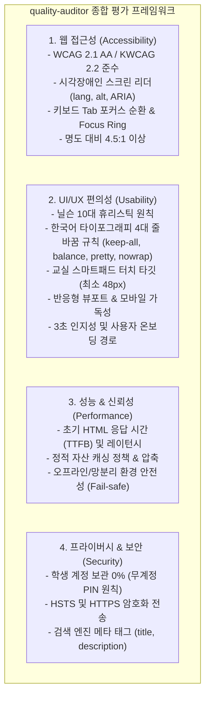

# quality-auditor — 웹 & 데스크톱 앱 종합 품질·접근성·편의성 자동 진단 스킬

이 스킬은 배포된 웹사이트와 로컬/원격 데스크톱 앱의 **웹 접근성(A11y)**, **UI/UX 편의성(Usability)**, **핵심 성능(Performance)**, **SEO 및 프라이버시 원칙**을 원클릭으로 정밀 감사(Audit)하고,
외부 의존성 없이 브라우저에서 바로 열리는 **단독 실행형 대화형 HTML 보고서(`docs/audits/quality-audit-report.html`)**를 생성하여 구체적인 코드 레벨 개선안을 도출합니다.

---

## 🎯 4대 핵심 평가 영역



---

## 🇰🇷 한국어 타이포그래피 4대 줄바꿈 감사 기준 (UI/UX 편의성 게이트)

AI 슬롭(Slop) 디자인의 대표적 결함인 한국어 어절 중간 끊김(`대한민 / 국`), 문단 마지막 줄 한 단어 고아(Orphan word), 버튼·배지 2줄 꺾임 현상을 정적 HTML/CSS 및 런타임 DOM(`getComputedStyle`) 수준에서 자동 감사(`scripts/ops/korean-typography-audit.ts`)합니다.

1. **금지 패턴 (`KR-TYPO-BREAK-ALL`, Critical):**
   - 한국어 헤딩·본문·카드 텍스트에 `word-break: break-all` 또는 Tailwind `break-all` 사용 시 즉시 Slop Gate 위반으로 차단합니다.
2. **본문·카드·설명 (`KR-TYPO-KEEP-ALL` / `KR-TYPO-OVERFLOW-WRAP`, Serious):**
   - 한국어 본문(`body`, `p`, `li`, `.card-desc`, `.field-value`)에는 반드시 `word-break: keep-all;`(`break-keep`)과 `overflow-wrap: break-word;`(`break-words`)를 함께 선언하여 어절 단위 줄바꿈과 긴 복합어/URL 안전 줄바꿈을 동시에 보장합니다.
3. **헤딩 균형 & 문단 고아 방지 (`KR-TYPO-HEADING-BALANCE` / `KR-TYPO-BODY-PRETTY`, Moderate):**
   - 헤딩·타이틀·배너(`h1`~`h4`, `.hero-title`, `.plan-title`)에는 `text-wrap: balance;`(`text-balance`)를 적용하고, 본문 단락(`p`, `li`)에는 `text-wrap: pretty;`(`text-pretty`)를 적용합니다.
4. **버튼·배지·짧은 라벨 단일 행 (`KR-TYPO-NOWRAP`, Serious/Moderate):**
   - 버튼(`button`, `.btn`), 배지(`.badge`, `.chip`, `.step-num`) 및 짧은 상태 라벨에는 `white-space: nowrap;`(`whitespace-nowrap`)을 적용합니다. 의도된 다중 행 개행 구간은 `white-space: pre-line;`(`whitespace-pre-line`)을 사용합니다.

### 권장 자동 교정 CSS 스니펫

```css
/* 한국어 타이포그래피 4대 줄바꿈 표준 가드 */
body, p, li, .card p, .card li, .field-value {
  word-break: keep-all;
  overflow-wrap: break-word;
  text-wrap: pretty;
}

h1, h2, h3, h4, .plan-title, .hero-title, .step-title {
  word-break: keep-all;
  overflow-wrap: break-word;
  text-wrap: balance;
}

button, .btn, .badge, .chip, .step-num {
  white-space: nowrap;
}

.multiline-copy {
  white-space: pre-line;
  word-break: keep-all;
  overflow-wrap: break-word;
}
```

---

## 🛠️ 실행 방법

### 1단계: 진단 스크립트 실행 (CLI)

```bash
# 기본 대상(edulinker.kr, cloud-school.kr, 구름학교 런처/에디터) 일괄 진단
node scripts/ops/audit-quality.mjs

# 특정 URL만 진단할 경우
node scripts/ops/audit-quality.mjs --url https://edulinker.kr

# JSON 출력만 필요할 경우 (CI 연동)
node scripts/ops/audit-quality.mjs --json

# 한국어 타이포그래피 4대 줄바꿈 정밀 감사 실행
node scripts/ops/korean-typography-audit.ts [파일경로...] [--json]
```

### 2단계: 결과 산출물 확인
- **대화형 HTML 대시보드**: `docs/audits/quality-audit-report.html`
  - 브라우저에서 더블 클릭하면 즉시 열리는 독립형 보고서.
  - 종합 스코어 카드 (100점 만점) 및 각 타겟별 탭 필터링.
  - 심각도(Critical, Serious, Moderate, Good) 필터 및 **권장 수정 코드 스니펫(CSS/HTML)** 제공.
- **기계 판독용 JSON**: `docs/audits/quality-audit-report.json`

### 3단계: 에이전트 지능형 브리핑 & 자동 리팩토링
에이전트는 보고서 생성 후 다음 3단계를 사용자에게 브리핑합니다:
1. **타겟별 스코어보드**: 접근성, 사용성, 성능, SEO 점수 요약.
2. **우선순위 개선 과제 (Critical / Serious)**:
   - 예: `<html>` 언어 속성 누락, 아이콘 전용 버튼의 `aria-label` 누락, 48px 미만 터치 타깃, 한국어 `word-break: break-all` 사용 또는 `keep-all`/`nowrap` 누락.
3. **원클릭 자동 수정 제안**: 사용자의 동의를 얻어 `fast-gate` 및 `tdd-loop` 스킬을 연동하여 코드를 즉시 교정.

---

## 💻 윈도우 데스크톱 앱 (런처 / 에디터) 감사 가이드

구름학교 런처 및 에디터 같은 WebView2 / Chromium 기반 윈도우 앱은 다음 플래그를 통해 웹과 동일한 심층 감사를 수행할 수 있습니다:

1. **Remote Debugging 활성화**:
   ```powershell
   # 런처 또는 에디터 실행 시 디버깅 포트 개방
   & "구름학교 런처.exe" --remote-debugging-port=9222
   ```
2. **자동 감사 연동**:
   `node scripts/ops/audit-quality.mjs` 실행 시 로컬 `9222` 포트가 열려 있으면, 내부 웹뷰 세션에 자동 연결하여 DOM/CSS/접근성을 실시간으로 감사하고 보고서에 병합합니다.
